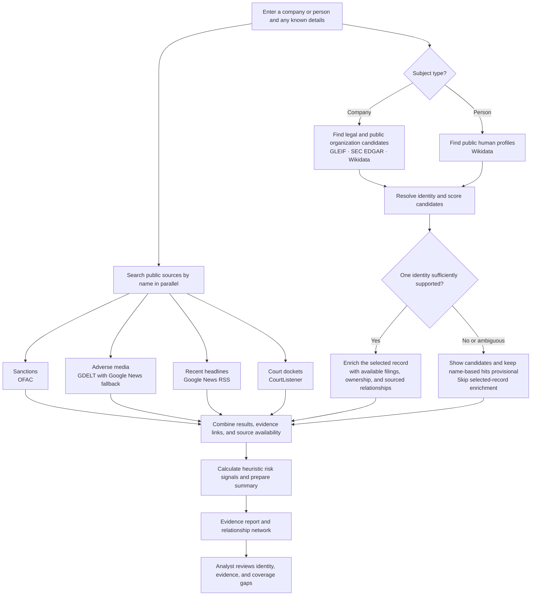

# Brahma

**Brahma is an evidence-led workspace for investigating companies and people.** It brings identity matching, public-source screening, news, legal records, and relationship evidence into one report so an analyst can see what was found, where it came from, and what still needs review.

It is designed for third-party risk research and due diligence workflows, and for developers who want to call the same investigation pipeline through an API or MCP server. Brahma is a research and decision-support tool; it does not certify a subject, make an onboarding decision, or replace a complete compliance review.

**Try the public demo:** [rushing-flint-zq5ceis.vercel.app](https://rushing-flint-zq5ceis.vercel.app/)

## What an investigation does

1. **Describe the subject.** Search for an organization or person. Add details such as a country, website, LEI, company number, known trading name, employer, or public profile ID to help distinguish namesakes.
2. **Resolve identity before interpreting results.** Brahma compares the submitted details with public records and shows candidates when more than one entity could match. A public profile match is labeled separately from a legal-entity match; neither a name similarity nor a registry result alone proves identity.
3. **Collect source results.** Available sources are queried for sanctions, legal and company records, adverse media, recent news, and litigation. The report shows source coverage so a timeout or unavailable provider is visible as a gap.
4. **Review evidence and relationships.** Inspect the source, date, link, match context, and relationship evidence behind a result. Identity candidates are kept distinct from company affiliations and other sourced connections.
5. **Decide what to investigate next.** Risk signals and recommendations summarize the available evidence. They are heuristic prompts for review, not a verdict or a probability that a subject is risky.

The identity lookup and the common screening searches run in parallel. This lets Brahma return useful evidence even if one provider is slow, while keeping unresolved names and unavailable sources visible in the report.



## What’s in the workspace

- **Investigate:** start company or person searches, add identity details, and open curated examples. Curated cases are clearly labeled as samples and are not live screening.
- **Evidence:** review sanctions, adverse media, recent news, litigation, ownership, risk categories, and source coverage. General recent news is shown separately from adverse-media findings.
- **Network:** inspect identity candidates and sourced connections. A search-result edge means “possible identity match”; it does not mean ownership or affiliation. Connection claims link back to their evidence.
- **Decision board:** explore structured strategy reviews. Curated example decisions work offline; live analysis may use a configured language-model provider.
- **Developers:** try the REST API, view the OpenAPI schema, and find the MCP client setup.

## Sources and interpretation

The live investigation uses public sources where available. Coverage depends on source availability, query quality, network access, and any provider limits.

| Source | Used for | Important limitation |
| --- | --- | --- |
| OFAC | U.S. sanctions list name screening | A non-match is not a global sanctions clearance. The list can be unavailable or out of date. |
| GLEIF | Legal-entity names, LEIs, and related registry records | A candidate must be selected or supported by identifiers when names are ambiguous. A registry result is not a screening clearance. |
| SEC EDGAR | U.S. public-company filings and company identifiers | SEC data does not cover every company. Requests need a real contact in `USER_AGENT`. |
| Wikidata | Public organization and person profiles, and sourced profile claims | Public-profile matching is not independent identity verification. Undated leadership or employer claims do not establish a current role. |
| GDELT and Google News RSS | Adverse-media search and recent headlines | Search results are bounded and name matched. A headline is a lead to review, not proof it concerns the selected person or entity. |
| CourtListener | Public U.S. court docket searches | Results are bounded title matches, not a complete lawsuit count or proof of wrongdoing. |

When a source does not respond, Brahma reports a coverage gap instead of treating the missing result as a clean finding. News coverage is not a complete archive; company filings, registries, and court searches have their own scope limits. Always inspect source links and dates before relying on a result.

## Run locally

Python 3.12 or newer is recommended. Node.js is not required to run the application. The following starts a local SQLite development instance:

### macOS and Linux

```bash
python3.12 -m venv .venv
source .venv/bin/activate
python -m pip install -r requirements.txt
mkdir -p data
DATABASE_URL=sqlite+aiosqlite:///./data/brahma.db \
  uvicorn app.main:app --host 127.0.0.1 --port 8770
```

### Windows PowerShell

```powershell
py -3.12 -m venv .venv
.\.venv\Scripts\Activate.ps1
python -m pip install -r requirements.txt
New-Item -ItemType Directory -Force data | Out-Null
.\scripts\start_brahma.ps1 -Port 8770
```

Run these commands from the repository root. Open [http://127.0.0.1:8770](http://127.0.0.1:8770). The interactive API documentation is at [http://127.0.0.1:8770/docs](http://127.0.0.1:8770/docs). The Windows launcher binds to loopback, writes logs under `artifacts/`, and reloads when backend Python files change.

Without a `DATABASE_URL`, the app uses the PostgreSQL URL from its defaults and falls back to a local SQLite database if PostgreSQL is unavailable. The commands above set SQLite explicitly for a simple local start.

## REST API

The primary endpoint accepts an organization or individual and returns an evidence-backed JSON report:

```bash
curl -X POST http://127.0.0.1:8770/api/v1/supplier/investigate \
  -H 'Content-Type: application/json' \
  -d '{
    "name": "OpenAI",
    "entity_type": "organization",
    "country": "United States",
    "website": "https://openai.com"
  }'
```

For a person, set `entity_type` to `individual`; optional `employer`, `country`, `date_of_birth`, and Wikidata `profile_id` fields can help distinguish people with the same name. For organizations, `registration_number` accepts an LEI, a company number, or a `CIK:<number>` identifier. `aliases` accepts known trading names or alternate spellings.

The response includes `entity_resolution`, `sanctions`, `adverse_media`, `recent_news`, `litigation`, `ownership`, `graph`, `risk`, `evidence`, and `sources_consulted`. The interactive API reference is at [http://127.0.0.1:8770/docs](http://127.0.0.1:8770/docs) while the service is running. The MCP wrapper reads `BRAHMA_URL`; `ARGUS_URL` remains supported for compatibility.

## Configuration

Most features can be explored without paid API keys. Copy `.env.example` to `.env` only when you need to configure providers. Never commit real credentials.

| Setting | What it enables | If it is unset |
| --- | --- | --- |
| `ANTHROPIC_API_KEY` | Claude-generated evidence report | A deterministic summary is built from collected evidence. |
| `OPENAI_API_KEY` | OpenAI embeddings for entity matching | Brahma uses another installed local backend or its built-in hashed text representation. |
| `OPENROUTER_API_KEY` | Live strategy-board analysis | Curated offline decision examples remain available. |
| `COURTLISTENER_API_TOKEN` | Higher-limit CourtListener requests | Court coverage may be limited or unavailable. |
| `USER_AGENT` | Identifies the app to SEC EDGAR | Set a real contact address for SEC requests. |
| `DATABASE_URL` | Selects the database | Local development falls back to SQLite if the default PostgreSQL URL is unavailable. |

Source access also depends on outbound network access. In restricted environments, allow the hosts used by the configured source adapters.

## Public demo and deployment

The Vercel demo is configured with `PUBLIC_DEMO=true`. It can run without paid AI keys, uses temporary storage for source caching, returns reports to the browser without saving them, and disables stored-report and administrative endpoints. Temporary storage may disappear, and external sources can be unavailable or rate limited.

The demo is for exploration, not shared production screening. A persistent deployment needs authentication and access controls, a managed database with backups and retention rules, rate limiting, monitoring, and a protected administrative API. `Dockerfile` and `render.yaml` provide alternate deployment starting points; configure PostgreSQL and set `ALLOW_SQLITE_FALLBACK=false` for a persistent service.

## Development

Install the optional test dependency and run the project checks:

```bash
python -m pip install pytest
python -m pytest tests -q
node --check static/app.js
```

See [docs/VERIFICATION.md](docs/VERIFICATION.md) for verification details and known limitations, [docs/QA_FINDINGS.md](docs/QA_FINDINGS.md) for review findings, and [PROVENANCE.md](PROVENANCE.md) for the project's adaptation history and attribution.

## How it is built

Brahma uses FastAPI and SQLAlchemy on the backend, asynchronous HTTP source adapters for public data, and a static HTML/CSS/JavaScript interface. The API and the browser workspace use the same investigation pipeline. Optional language-model providers help produce narrative summaries; source retrieval, entity matching, coverage reporting, and risk signals remain explicit parts of the returned report.

This repository adapts an existing project with permission from its original author. See [PROVENANCE.md](PROVENANCE.md) for details. The Lucide license is included under `static/vendor/`.
